# Design Patterns: Zero to Hero

## A Visual Guide to Understanding, Implementing, and Applying Software Design Patterns

**A practical, example-driven learning guide**  
**Primary language:** TypeScript  
**Audience:** Developers who know basic programming and want to make better design decisions

> **Learning principle:** Understand the recurring problem first; use an everyday analogy to make it concrete; then study the software design, implementation, trade-offs, and alternatives.

---

## How to use this guide

Read Parts I–IV in order the first time. After that, use the pattern catalog and comparison tables as a reference. For each pattern, try to explain the problem in your own words before looking at the code. Then implement the exercise without copying the example.

Diagrams are Mermaid source. A Markdown viewer that supports Mermaid can render them; otherwise, the fenced blocks remain readable source, not embedded images. All examples are teaching examples, not claims about any particular production framework. Snippets focus on design, so application-specific I/O, persistence, and validation are sometimes omitted.

## Contents

1. [Learning progression and central analogy](#learning-progression-and-central-analogy)
2. [Part I — Foundations](#part-i-foundations)
   - [1. What design patterns are](#1-what-design-patterns-are)
   - [2. Object-oriented design from zero](#2-object-oriented-design-from-zero)
   - [3. SOLID principles](#3-solid-principles)
   - [4. Recognizing design problems](#4-recognizing-design-problems)
3. [Part II — Creational patterns](#part-ii-creational-patterns)
   - [5. Singleton](#5-singleton)
   - [6. Factory Method](#6-factory-method)
   - [7. Abstract Factory](#7-abstract-factory)
   - [8. Builder](#8-builder)
   - [9. Prototype](#9-prototype)
4. [Part III — Structural patterns](#part-iii-structural-patterns)
   - [10. Adapter](#10-adapter)
   - [11. Bridge](#11-bridge)
   - [12. Composite](#12-composite)
   - [13. Decorator](#13-decorator)
   - [14. Facade](#14-facade)
   - [15. Flyweight](#15-flyweight)
   - [16. Proxy](#16-proxy)
5. [Part IV — Behavioral patterns](#part-iv-behavioral-patterns)
   - [17. Chain of Responsibility](#17-chain-of-responsibility)
   - [18. Command](#18-command)
   - [19. Interpreter](#19-interpreter)
   - [20. Iterator](#20-iterator)
   - [21. Mediator](#21-mediator)
   - [22. Memento](#22-memento)
   - [23. Observer](#23-observer)
   - [24. State](#24-state)
   - [25. Strategy](#25-strategy)
   - [26. Template Method](#26-template-method)
   - [27. Visitor](#27-visitor)
   - [28. Related patterns and architecture techniques](#28-related-patterns-and-architecture-techniques)
6. [Part V — Comparing similar patterns](#part-v-comparing-similar-patterns)
7. [Part VI — Patterns in applications and refactoring](#part-vi-patterns-in-applications-and-refactoring)
8. [Part VII — Recognition, interviews, practice, and roadmap](#part-vii-recognition-interviews-practice-and-roadmap)
9. [Appendices](#appendices)

## Learning progression and central analogy

### Progression

| Stage | Learn | Evidence of understanding |
|---|---|---|
| 1. Foundations | Objects, interfaces, composition, coupling, SOLID | Explain why a change is difficult before naming a pattern |
| 2. Recognition | Code smells and recurring design forces | Offer more than one candidate solution |
| 3. Catalog | Creational, structural, behavioral patterns | Draw participants and trace a runtime call |
| 4. Judgment | Similar patterns, costs, alternatives | Explain why a pattern is not needed |
| 5. Application | Refactoring, testing, enterprise examples | Make one small behavior-preserving change at a time |
| 6. Mastery | Practice, interviews, decision notes | Defend a design with evidence and trade-offs |

### Restaurant map

The restaurant grows from one owner doing everything into a business with ordering channels, kitchen stations, payment options, notification subscribers, delivery partners, and configurable menus. The analogy helps identify forces, but it is not an exact model of software: restaurant employees are people, while software objects have explicit types, lifetimes, and call semantics.

| Restaurant situation | Candidate software concept |
|---|---|
| Select cash, card, or wallet payment | Strategy |
| Create a kitchen ticket without exposing construction | Factory Method |
| Choose a compatible suite of equipment for each restaurant format | Abstract Factory |
| Assemble a customizable meal/order | Builder |
| Share a menu template by copying it | Prototype |
| Translate a delivery partner's API to the house contract | Adapter |
| Add optional toppings or fees around an order operation | Decorator |
| Give staff one entry point to a multi-step order process | Facade |
| Notify subscribed customers when status changes | Observer |
| Move an order through valid lifecycle stages | State |
| Let a request pass through approval checks | Chain of Responsibility |
| Store an action as a queueable ticket | Command |
| Share immutable menu-category data | Flyweight |
| Control or delay access to a remote kitchen service | Proxy |
| Coordinate stations that should not call each other directly | Mediator |
| Browse a menu without exposing its storage | Iterator |
| Save and restore an order draft | Memento |

---

# Part I — Foundations

## 1. What design patterns are

A **design pattern** is a named, reusable way to structure a solution to a recurring design problem in a particular context. It describes roles and relationships, not a finished program to paste in.

Patterns exist because teams repeatedly encounter the same forces: changing requirements, external dependencies, object creation, collaboration, and complexity. A shared pattern name lets a team discuss a design efficiently. A pattern is useful only when its trade-offs fit the problem.

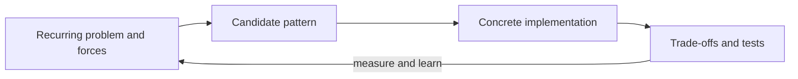

| Concept | Main concern | Example |
|---|---|---|
| Design pattern | Collaboration and responsibility structure | Strategy for interchangeable payment rules |
| Algorithm | Steps to compute a result | Binary search |
| Data structure | How data is organized and accessed | Hash map |
| Architecture pattern | Large-scale system organization | Layered architecture |
| Coding convention | Consistent source-code style | Naming methods in `camelCase` |

The Gang of Four (Erich Gamma, Richard Helm, Ralph Johnson, and John Vlissides) published *Design Patterns: Elements of Reusable Object-Oriented Software* in 1994. Its 23 patterns became an influential catalog, not an exhaustive list of every useful design technique. Patterns are reusable design knowledge, not copy-and-paste code.

**Benefits:** common vocabulary, clearer responsibilities, known extension points, and a starting point for discussion.  
**Costs:** more types, indirection, learning overhead, and sometimes slower debugging. Overengineering occurs when the abstraction costs more than the change it protects against.

**Decision check:** What is changing? What must remain stable? How often does the change happen? Could a function, conditional, or existing framework feature be simpler?

## 2. Object-oriented design from zero

- **Class:** a type definition describing data and behavior. `class Order { total = 0; }`
- **Object:** a runtime instance of a class. `const lunch = new Order();`
- **Property:** data associated with an object. **Method:** behavior it provides.
- **Encapsulation:** keep implementation details behind a small public interface.
- **Abstraction:** represent the relevant behavior while hiding irrelevant detail.
- **Interface:** a contract describing operations; it does not prescribe their implementation.
- **Abstract class:** a partially implemented base class that may require subclasses to fill in behavior.
- **Inheritance:** a subtype reuses or specializes a base type. It expresses an “is-a” relationship only when the subtype can safely stand in for the base.
- **Polymorphism:** code can call a shared contract while different implementations respond differently.
- **Composition:** build behavior by holding and collaborating with other objects.
- **Association:** objects know or use one another. **Aggregation:** a whole refers to parts that may live independently. **Composition:** a whole owns parts whose lifecycle is tied to it. UML diamonds communicate intent; exact lifecycle meaning depends on the domain.
- **Coupling:** how strongly one part depends on another. **Cohesion:** how closely a module's responsibilities belong together.
- **Dependency direction:** which module knows about which other module. Designs are usually easier to change when stable business rules do not depend directly on volatile infrastructure.

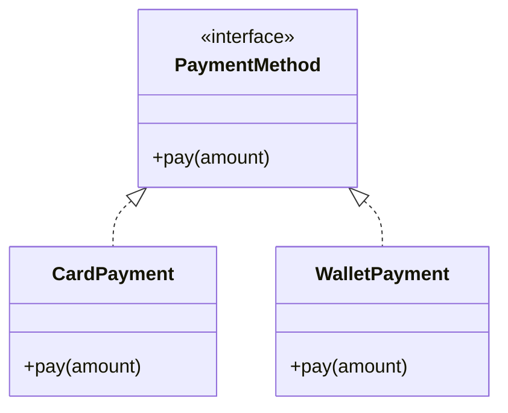

Both classes satisfy `PaymentMethod`; an order can use either without knowing its concrete type. Prefer composition when a class needs interchangeable behavior:

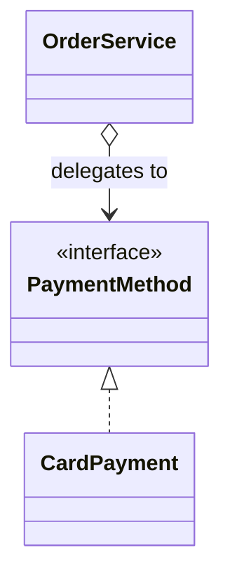

Inheritance can lead to a class explosion when independent dimensions multiply (for example, three channels × four payment methods). Composition lets a channel hold a payment strategy instead. Do not reject inheritance categorically: stable “is-a” taxonomies and framework extension points may warrant it.

## 3. SOLID principles

SOLID is a set of design heuristics. It does not certify that a design is good; each principle requires judgment.

### S — Single Responsibility Principle
**Plain English:** a module should have one coherent reason to change. **Technical view:** group responsibilities that change together and separate those that change for unrelated stakeholders.

Bad: `OrderManager` validates orders, writes database rows, charges cards, and formats emails. A tax-rule change could break persistence or notifications. Split policy, persistence, and delivery at meaningful boundaries; avoid creating a class for every line of code.

### O — Open/Closed Principle
**Plain English:** add a supported variation without repeatedly editing stable decision logic. **Technical view:** extension points should allow relevant behavior to vary while limiting changes to tested core code.

Bad: a payment method `switch` grows whenever a provider is added. An interface with focused implementations may isolate variation. OCP does not mean “never modify existing code”; a new requirement can legitimately change a model.

### L — Liskov Substitution Principle
**Plain English:** a subtype should honor the promises of its base type. **Technical view:** replacing a base instance with a subtype should not violate callers' expectations or invariants.

If `PaymentMethod.pay` promises a completed or explicit failed result, a subtype must not silently return success without charging. Review preconditions, postconditions, invariants, and error semantics—not just method signatures.

### I — Interface Segregation Principle
**Plain English:** clients should not depend on operations they do not use. **Technical view:** split broad contracts into cohesive, client-specific contracts where this reduces unwanted coupling.

Instead of `KitchenDevice` requiring `print`, `heat`, `scan`, and `dispense`, a label printer can implement only `print`. Avoid fragmenting interfaces into meaningless one-method types without a client need.

### D — Dependency Inversion Principle
**Plain English:** business policy should not be hard-wired to a low-level vendor detail. **Technical view:** high- and low-level modules depend on abstractions; details implement contracts owned at an appropriate boundary.

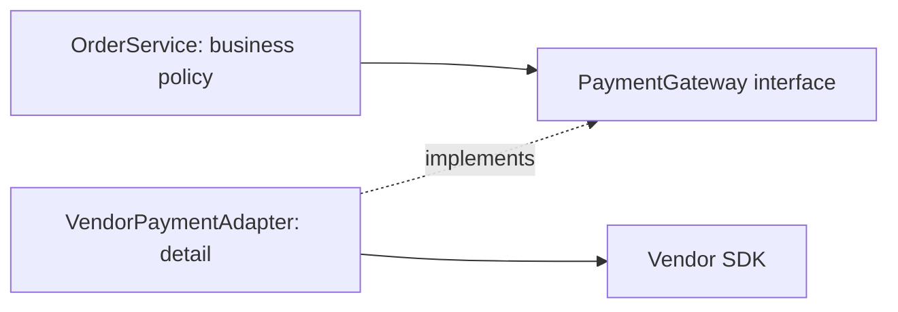

**Dependency injection (DI)** means supplying an object's collaborators rather than having it construct them internally. It is a technique for wiring dependencies, not itself a GoF pattern. DI improves replaceability and testing when used at real boundaries; a framework container is optional.

| Principle | Design question | Possible supporting patterns |
|---|---|---|
| SRP | Do unrelated reasons to change share this module? | Facade, Command, Repository |
| OCP | Is a likely variation isolated? | Strategy, Decorator, Factory Method |
| LSP | Does every implementation preserve the contract? | State, Strategy |
| ISP | Are clients forced to know unused operations? | Small role interfaces |
| DIP | Do business rules depend directly on vendor details? | Adapter, ports-and-adapters, DI |

No pattern guarantees SOLID compliance. A giant `Strategy` interface or `Facade` can violate the same principles it was meant to help.

## 4. Recognizing design problems

A **code smell** is a clue worth investigating, not automatic proof of a defect.

| Observation | Possible concern | Candidates to evaluate | Check before adopting |
|---|---|---|---|
| Large conditional selects algorithms | Variation mixed with workflow | Strategy, State | Is there more than one real variant? |
| Repeated object setup | Creation rules scattered | Factory, Builder | Would a named function suffice? |
| Many unrelated changes in one class | Mixed responsibilities | Facade + collaborators, SRP refactor | Do the responsibilities actually change independently? |
| Vendor-specific calls spread through code | Tight external coupling | Adapter | Is the vendor interface stable and already adequate? |
| Notification loops copied everywhere | Subscriber lifecycle coupled to producer | Observer / Pub-Sub | Are subscriptions or independent consumers needed? |
| Hard to test due to hidden globals | Hidden dependency | DI, explicit parameters | Can a small function eliminate the global? |
| Deep inheritance tree | Fragile base-class coupling | Composition, Bridge, Strategy | Is the hierarchy stable and substitutable? |
| Shared mutable global configuration | Hidden state and test interference | Explicit configuration, possibly Singleton | Is shared identity truly required? |

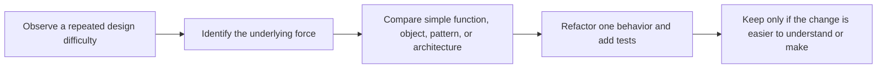

# Part II — Creational patterns

Creational patterns separate the decision to create an object from the code that uses it. They are helpful when construction or product choice is a real source of change—not merely because `new` appears.

## 5. Singleton

**Category:** Creational. **Intent:** ensure a type has one shared instance and provide access to it.  
**Restaurant analogy:** one centrally managed configuration board. The analogy breaks down because software singleton state is process-scoped (not necessarily shared across machines) and can make dependencies invisible.

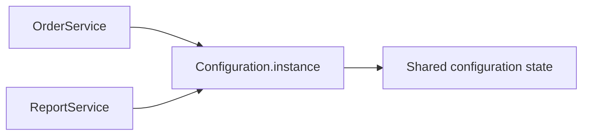

```ts
class AppConfig {
  private static instance?: AppConfig;
  private constructor(readonly currency = "USD") {}
  static getInstance(): AppConfig {
    return (this.instance ??= new AppConfig());
  }
}
```

This is lazy initialization. In ordinary JavaScript execution, synchronous initialization is straightforward; multi-threaded runtimes and cross-process coordination need separate analysis. A module-level export is often a simpler singleton-like instance. A singleton does not mean “one per distributed system.”

**Without it:** each consumer can construct its own config, leading to inconsistent values if shared identity is required. **Trade-offs:** global access hides dependencies, complicates isolated tests, and carries mutable state across test cases. Prefer injecting an immutable `AppConfig` instance. Use a singleton only when one instance is a true domain/runtime constraint and its lifecycle is clear. **Related:** DI, Service Locator, Flyweight.

## 6. Factory Method

**Category:** Creational. **Intent:** let a creator's subclasses decide which product implementation to construct.  
**Restaurant analogy:** each branch creates its local kitchen ticket according to its rules; the client asks for a ticket without depending on the concrete class.

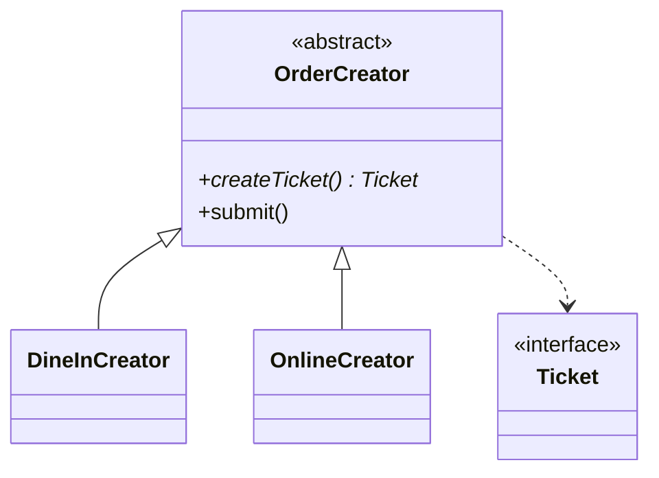

```ts
interface Ticket { route(): string; }
class CounterTicket implements Ticket { route() { return "counter"; } }
class OnlineTicket implements Ticket { route() { return "online"; } }
abstract class TicketCreator {
  protected abstract createTicket(): Ticket;
  submit(): string { return this.createTicket().route(); }
}
class CounterCreator extends TicketCreator {
  protected createTicket(): Ticket { return new CounterTicket(); }
}
class OnlineCreator extends TicketCreator {
  protected createTicket(): Ticket { return new OnlineTicket(); }
}
const submittedViaWeb = new OnlineCreator().submit();
```

**Without it:** the workflow branches on channel and constructs concrete tickets. **Improvement:** creation varies behind an overridable method while submission remains shared. **Costs:** subclasses and inheritance; if there is only one construction site, a simple factory function may be clearer. Adding a product generally requires a creator implementation. **Related:** Simple Factory, Abstract Factory, Builder.

## 7. Abstract Factory

**Category:** Creational. **Intent:** create compatible families of related products without naming concrete classes.  
**Restaurant analogy:** a kiosk-format branch gets compatible screen, receipt printer, and payment terminal products. This is most useful when products must vary together.

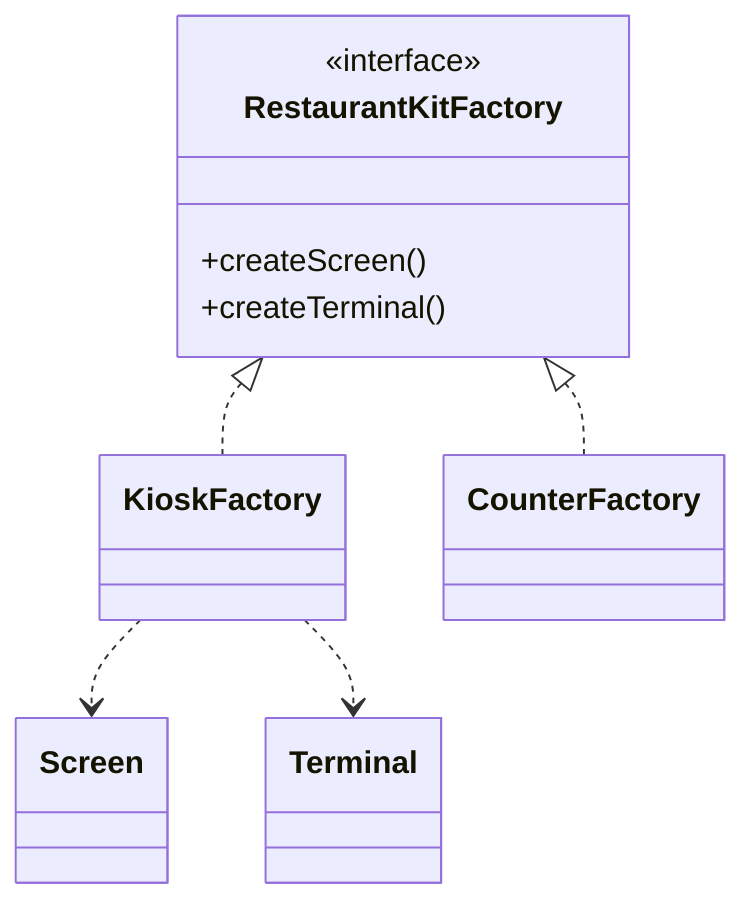

```ts
interface Screen { show(orderId: string): void; }
interface Terminal { charge(amount: number): void; }
class KioskScreen implements Screen { show(_orderId: string): void {} }
class KioskTerminal implements Terminal { charge(_amount: number): void {} }
interface RestaurantKitFactory {
  createScreen(): Screen;
  createTerminal(): Terminal;
}
class KioskFactory implements RestaurantKitFactory {
  createScreen(): Screen { return new KioskScreen(); }
  createTerminal(): Terminal { return new KioskTerminal(); }
}
```

A client receives one factory and makes a consistent family. **Without it:** scattered conditionals can accidentally mix incompatible products. **Trade-off:** adding a new family is straightforward; adding a new product kind forces factory interfaces and implementations to change. **Related:** Factory Method (often used inside a factory), simple factory.

## 8. Builder

**Category:** Creational. **Intent:** construct a complex object step by step, separating construction from representation.  
**Restaurant analogy:** customize a meal with required size and optional sides, toppings, and sauces.

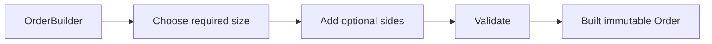

```ts
type Meal = Readonly<{ size: "small" | "large"; sides: readonly string[]; sauce?: string }>;
class MealBuilder {
  private size?: Meal["size"];
  private sides: string[] = [];
  private sauce?: string;
  withSize(size: Meal["size"]): this { this.size = size; return this; }
  addSide(side: string): this { this.sides.push(side); return this; }
  withSauce(sauce: string): this { this.sauce = sauce; return this; }
  build(): Meal {
    if (!this.size) throw new Error("Meal size is required");
    return Object.freeze({ size: this.size, sides: [...this.sides], sauce: this.sauce });
  }
}
```

**Without it:** a long positional constructor is hard to read and easy to misuse. Builder names optional choices and validates at `build`. **Trade-offs:** extra code and mutable intermediate builder state. For a small object, an options object or constructor is simpler. **Related:** Factory (chooses a type), Prototype (copies a seed object).

## 9. Prototype

**Category:** Creational. **Intent:** create a new object by copying a configured prototype.  
**Restaurant analogy:** duplicate a menu template, then customize the copy.

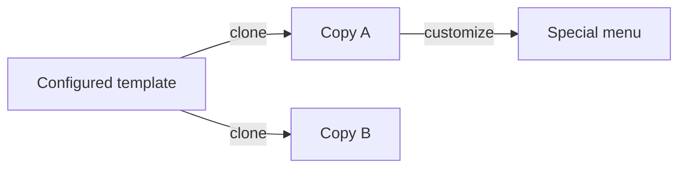

```ts
type MenuTemplate = { name: string; sections: string[] };
const standard: MenuTemplate = { name: "Standard", sections: ["Lunch", "Dinner"] };
const seasonal: MenuTemplate = { ...standard, sections: [...standard.sections], name: "Seasonal" };
seasonal.sections.push("Autumn");
```

The object spread plus copied nested array is a deliberate **deep-enough copy** for this shape. A shallow spread alone would share `sections`; mutations would leak between copies. JavaScript has no universal deep clone semantics for arbitrary class instances, dates, resources, or functions. Define clone behavior explicitly. **Use when:** copying a configured object is cheaper or clearer than rebuilding it. **Avoid:** ambiguous ownership, hidden shared mutable data, or cloning objects with resources. **Related:** Builder.

# Part III — Structural patterns

Structural patterns compose types and objects into useful larger structures.

## 10. Adapter

**Category:** Structural. **Intent:** translate one interface into the interface a client expects.  
**Analogy:** a travel plug adapter connects different plug shapes; it does not redesign the electrical appliance.

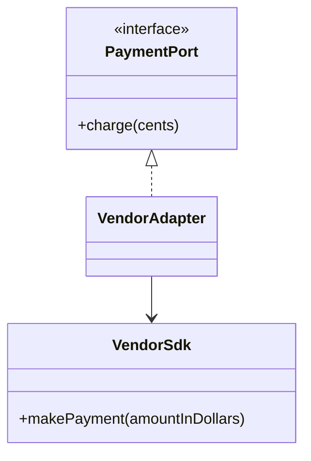

```ts
interface PaymentPort { charge(cents: number): Promise<void>; }
class VendorSdk { async makePayment(dollars: number): Promise<void> {} }
class VendorAdapter implements PaymentPort {
  constructor(private readonly sdk: VendorSdk) {}
  charge(cents: number): Promise<void> {
    if (!Number.isInteger(cents) || cents < 0) throw new Error("Invalid cents");
    return this.sdk.makePayment(cents / 100);
  }
}
```

**Without it:** business code calls vendor-specific methods and units everywhere. The adapter centralizes translation and validation. **Object Adapter** wraps a collaborator (shown); **Class Adapter** uses inheritance where the language permits and it is appropriate. For third-party APIs, object composition is generally more flexible. **Costs:** another layer and potential semantic mismatch. **Related:** Facade simplifies a subsystem; Proxy controls access; Decorator adds behavior.

## 11. Bridge

**Category:** Structural. **Intent:** separate an abstraction from its implementation so both can vary independently.  
**Analogy:** restaurant ordering channels (web, counter) can pair with fulfillment modes (pickup, delivery). The channel is not a subtype of every possible pairing.

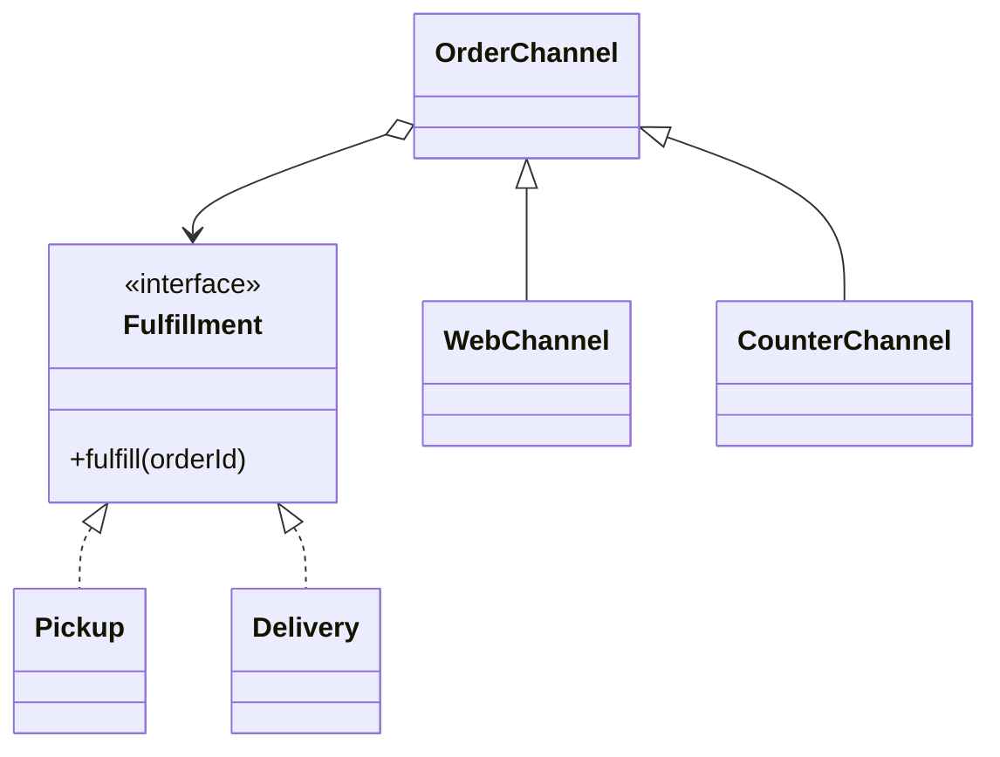

Composition yields 2 channel types + 2 fulfillment types instead of potentially 4 paired subclasses, and avoids multiplying further dimensions. **Use when:** both abstraction and implementation have meaningful independent variation. **Avoid:** a stable one-dimensional type where an interface is enough. **Related:** Adapter often joins interfaces after they exist; Bridge plans independent variation up front.

```ts
interface Fulfillment { fulfill(orderId: string): string; }
class Pickup implements Fulfillment {
  fulfill(orderId: string): string { return `Pickup ${orderId}`; }
}
class Delivery implements Fulfillment {
  fulfill(orderId: string): string { return `Deliver ${orderId}`; }
}
class WebOrderChannel {
  constructor(private readonly fulfillment: Fulfillment) {}
  submit(id: string): string { return this.fulfillment.fulfill(id); }
}
const onlineDelivery = new WebOrderChannel(new Delivery());
```

## 12. Composite

**Category:** Structural. **Intent:** treat individual objects and compositions of objects uniformly in a tree.  
**Analogy:** a branch contains departments and employees; a branch-wide operation can recurse through its children.

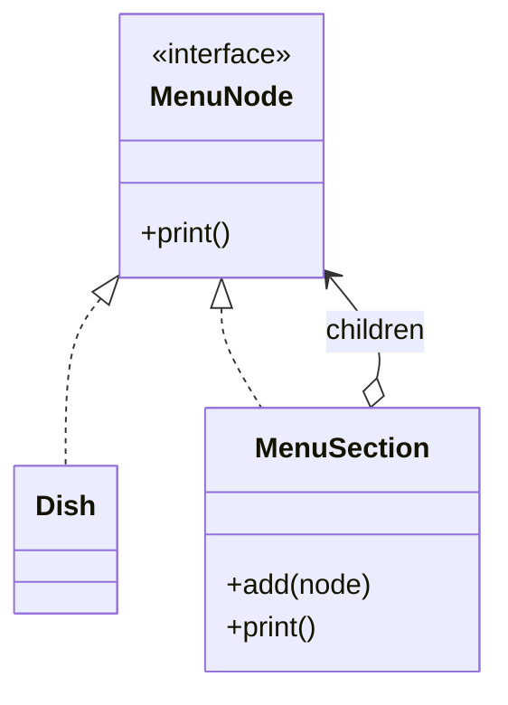

```ts
interface MenuNode { print(): string; }
class Dish implements MenuNode {
  constructor(private readonly name: string) {}
  print(): string { return this.name; }
}
class MenuSection implements MenuNode {
  private children: MenuNode[] = [];
  add(child: MenuNode): void { this.children.push(child); }
  print(): string { return this.children.map(x => x.print()).join("\n"); }
}
```

**Without it:** client code distinguishes leaves from groups at every call site. **Trade-offs:** uniform APIs may expose operations that make no sense for leaves; recursive cycles need guarding if permitted. **Use for:** trees, UI trees, nested permissions, and document nodes. **Related:** Decorator wraps one component to add behavior; Composite has many children.

## 13. Decorator

**Category:** Structural. **Intent:** attach behavior to an individual object by wrapping it behind the same interface.  
**Analogy:** add optional toppings and fees to a base meal. Each wrapper contributes behavior and delegates.


```ts
interface OrderPrice { total(): number; }
class BaseOrder implements OrderPrice { total(): number { return 10; } }
class Extra implements OrderPrice {
  constructor(private readonly inner: OrderPrice, private readonly cost: number) {}
  total(): number { return this.inner.total() + this.cost; }
}
const order: OrderPrice = new Extra(new BaseOrder(), 2);
```

Wrapper order matters when operations are not commutative (discount before/after tax). **Without it:** subclasses for every combination multiply rapidly. **Trade-offs:** runtime object stacks can complicate debugging and identity checks. **Use when:** optional combinations vary per instance. **Related:** Proxy shares a wrapper shape but controls access; it does not primarily add responsibilities.

## 14. Facade

**Category:** Structural. **Intent:** provide a simpler entry point to a complex subsystem.  
**Analogy:** a restaurant manager coordinates ordering, kitchen, payment, and delivery so a customer-facing workflow has one clear call.

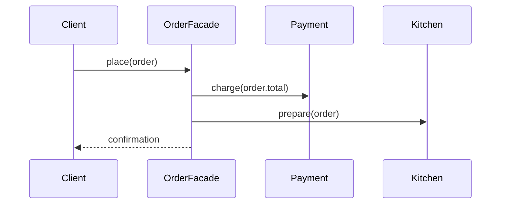

**Without it:** every client duplicates subsystem sequencing. A facade centralizes a common workflow, but it should not become an all-knowing “god object.” Keep domain rules in their appropriate collaborators. **Related:** Adapter changes an interface; Mediator coordinates peer objects; Facade offers a simpler subsystem interface.

```ts
interface Payments { charge(orderId: string, total: number): Promise<void>; }
interface Kitchen { prepare(orderId: string): Promise<void>; }
class CheckoutFacade {
  constructor(private readonly payments: Payments, private readonly kitchen: Kitchen) {}
  async place(orderId: string, total: number): Promise<void> {
    await this.payments.charge(orderId, total);
    await this.kitchen.prepare(orderId);
  }
}
```

In production, define what happens if kitchen preparation fails after a successful charge; the facade does not make distributed side effects transactional.

## 15. Flyweight

**Category:** Structural. **Intent:** reduce memory by sharing common, preferably immutable state among many objects; pass unique state externally.  
**Analogy:** menu entries can refer to shared immutable category descriptions rather than copying the same long description into every item.

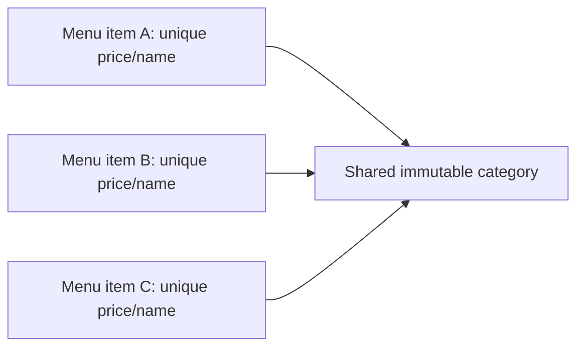

Separate **intrinsic state** (shared category label/style) from **extrinsic state** (item-specific price or quantity). Measure memory first; object pooling is not the same pattern and can add lifecycle complexity. Never mutate shared state as if it were per-instance. **Use when:** many objects duplicate expensive common data. **Related:** Singleton shares one identity; Flyweight shares reusable state across many logical objects.

```ts
type Category = Readonly<{ label: string; color: string }>;
class CategoryFactory {
  private readonly cache = new Map<string, Category>();
  get(label: string, color: string): Category {
    const key = `${label}:${color}`;
    let value = this.cache.get(key);
    if (!value) {
      value = Object.freeze({ label, color });
      this.cache.set(key, value);
    }
    return value;
  }
}
type MenuEntry = { name: string; price: number; category: Category };
```

`MenuEntry` owns unique values; entries with the same category share the immutable cached object. A real cache should define key normalization and lifecycle.

## 16. Proxy

**Category:** Structural. **Intent:** provide a substitute that controls access to a real subject with the same contract.  
**Analogy:** a booking desk checks access or availability before reaching the manager.

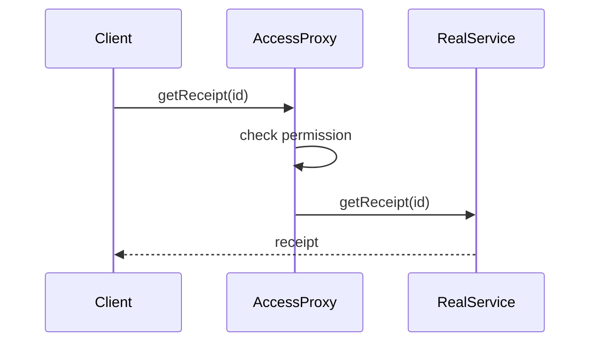

Proxy varieties include **virtual** (lazy load), **protection** (authorization), **remote** (local stand-in for remote access), and **caching**. **Costs:** hidden latency, stale cache risk, and error/permission semantics. Do not treat a proxy as security by itself; authorization must be enforced at the trusted boundary. **Distinguish:** Adapter translates, Decorator adds behavior, Proxy controls access or lifecycle.

```ts
interface ReceiptService { getReceipt(id: string): Promise<string>; }
class RealReceiptService implements ReceiptService {
  async getReceipt(id: string): Promise<string> { return `receipt:${id}`; }
}
class AuthorizedReceiptProxy implements ReceiptService {
  constructor(
    private readonly real: ReceiptService,
    private readonly canRead: (id: string) => boolean
  ) {}
  getReceipt(id: string): Promise<string> {
    if (!this.canRead(id)) return Promise.reject(new Error("Forbidden"));
    return this.real.getReceipt(id);
  }
}
```

# Part IV — Behavioral patterns

Behavioral patterns organize communication and responsibility among objects.

## 17. Chain of Responsibility

**Category:** Behavioral. **Intent:** pass a request along potential handlers until one handles it or the chain ends.  
**Analogy:** a complaint passes from customer service to supervisor to manager.

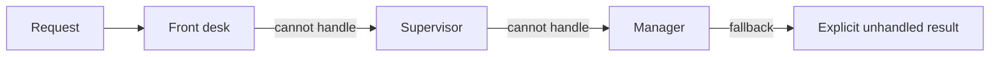

```ts
type Request = { amount: number };
type Result = { approved: boolean; handledBy: string };
interface Handler { setNext(next: Handler): Handler; handle(r: Request): Result | undefined; }
```

Handlers should define order, termination, and fallback explicitly; silently dropping a request is dangerous. **Without it:** conditionals in one coordinator grow. **Use when:** orderable checks can independently handle/pass a request (validation, approval, middleware). **Trade-offs:** tracing the final handler is harder. **Related:** Decorator always delegates through wrappers; a chain may stop when handled.

```ts
type Approval = { approved: boolean; handledBy: string };
interface Approver { setNext(next: Approver): Approver; handle(amount: number): Approval; }
abstract class BaseApprover implements Approver {
  private next?: Approver;
  setNext(next: Approver): Approver { this.next = next; return next; }
  handle(amount: number): Approval {
    if (this.canApprove(amount)) return { approved: true, handledBy: this.name };
    if (this.next) return this.next.handle(amount);
    return { approved: false, handledBy: "unhandled" };
  }
  protected abstract readonly name: string;
  protected abstract canApprove(amount: number): boolean;
}
class Supervisor extends BaseApprover {
  protected readonly name = "supervisor";
  protected canApprove(amount: number): boolean { return amount <= 100; }
}
class Manager extends BaseApprover {
  protected readonly name = "manager";
  protected canApprove(amount: number): boolean { return amount <= 1000; }
}
const supervisor = new Supervisor();
supervisor.setNext(new Manager());
const result = supervisor.handle(500);
```

## 18. Command

**Category:** Behavioral. **Intent:** encapsulate a request/action as an object, separating the invoker from the receiver.  
**Analogy:** an order ticket records a kitchen action that can be queued and executed later.

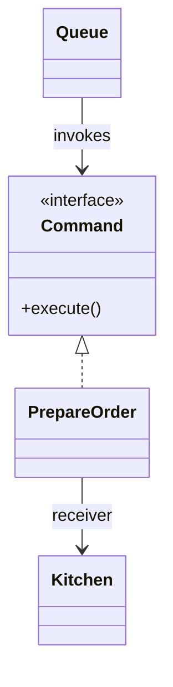

```ts
interface Command { execute(): Promise<void>; }
class PrepareOrder implements Command {
  constructor(private readonly orderId: string, private readonly kitchen: Kitchen) {}
  execute(): Promise<void> { return this.kitchen.prepare(this.orderId); }
}
class Kitchen { async prepare(_id: string): Promise<void> {} }
```

**Use for:** queues, retries, audit, scheduling, undo/redo when inverse state is known. Undo is not automatic: command must retain enough state or provide a correct inverse, and external side effects may be irreversible. A **command** is an instruction; an **event** is a fact that something happened. **Trade-offs:** many command types and serialization/versioning concerns. A function may be simpler for a local callback.

## 19. Interpreter

**Category:** Behavioral. **Intent:** represent and evaluate sentences in a small grammar.  
**Analogy:** interpret a tiny restaurant rule language such as “large AND vegetarian.”

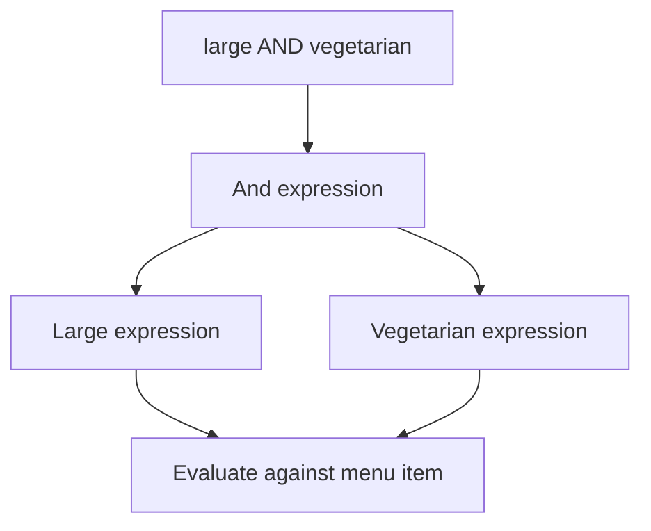

An expression interface might expose `interpret(context): boolean`; terminal expressions test a field, while nonterminal expressions combine child expressions. The AST (abstract syntax tree) is a tree representing the rule. For complex, user-authored, or untrusted grammars, use a real parser with explicit limits rather than growing ad-hoc `eval`-like logic. **Related:** Specification often expresses composable business predicates; a parser handles syntax before interpretation.

```ts
type MenuItem = { large: boolean; vegetarian: boolean };
interface Rule { matches(item: MenuItem): boolean; }
class Large implements Rule { matches(item: MenuItem): boolean { return item.large; } }
class Vegetarian implements Rule { matches(item: MenuItem): boolean { return item.vegetarian; } }
class And implements Rule {
  constructor(private readonly left: Rule, private readonly right: Rule) {}
  matches(item: MenuItem): boolean {
    return this.left.matches(item) && this.right.matches(item);
  }
}
const special = new And(new Large(), new Vegetarian());
```

This evaluates a prebuilt expression tree; parsing text such as `"large AND vegetarian"` is a separate concern.

## 20. Iterator

**Category:** Behavioral. **Intent:** traverse a collection without exposing its internal representation.  
**Analogy:** browse a menu without knowing whether it is stored as a list, tree, or remote page.

```mermaid
sequenceDiagram
  participant Client
  participant I as Iterator
  participant C as Collection
  Client->>I: next()
  I->>C: read next item
  C-->>Client: item
```

TypeScript's iterable protocol (`[Symbol.iterator]`) and `for...of` already provide this pattern idiomatically. Different iterators can implement depth-first, filtered, or paginated traversal. Concurrent mutation can invalidate traversal or produce inconsistent results; define collection semantics. Streams/lazy pipelines compose transformations and may be single-use; an iterator is the traversal protocol underneath many such APIs.

```ts
class Menu {
  constructor(private readonly dishes: readonly string[]) {}
  *[Symbol.iterator](): Iterator<string> {
    for (const dish of this.dishes) yield dish;
  }
}
const lunch = new Menu(["Soup", "Salad"]);
for (const dish of lunch) console.log(dish);
```

## 21. Mediator

**Category:** Behavioral. **Intent:** centralize complex communication among peer objects to reduce direct many-to-many dependencies.  
**Analogy:** a coordinator connects kitchen, delivery, payment, and customer-support teams.

```mermaid
flowchart LR
  A[Kitchen] --> M[OrderCoordinator]
  B[Payment] --> M
  C[Delivery] --> M
  M --> A
  M --> B
  M --> C
```

The mediator knows the collaboration rules; colleagues notify it rather than calling every peer. **Benefit:** fewer peer dependencies. **Risk:** all behavior can accumulate in a “god mediator.” Keep it cohesive and move domain policy to domain objects/services. **Distinguish:** Facade simplifies an interface for a client; Mediator coordinates peers; Observer broadcasts to subscribers.

```ts
interface OrderMediator { paymentCompleted(orderId: string): Promise<void>; }
class KitchenStation {
  constructor(private readonly mediator: OrderMediator) {}
  paymentReceived(orderId: string): Promise<void> {
    return this.mediator.paymentCompleted(orderId);
  }
}
class OrderCoordinator implements OrderMediator {
  constructor(private readonly prepare: (id: string) => Promise<void>) {}
  paymentCompleted(orderId: string): Promise<void> { return this.prepare(orderId); }
}
```

## 22. Memento

**Category:** Behavioral. **Intent:** capture and restore an object's state without exposing its internals.  
**Analogy:** save an order draft before editing, then restore a prior draft.

```mermaid
flowchart LR
  O[Originator] -->|save snapshot| M[Memento]
  M --> H[History / caretaker]
  H -->|restore snapshot| O
```

The originator creates a snapshot; a caretaker stores it and requests restoration. Snapshots can consume memory; immutable snapshots, bounded history, and compression may help. **Memento** stores state snapshots; **event sourcing** stores a sequence of domain facts and reconstructs state. They solve different persistence/history problems.

```ts
type DraftSnapshot = Readonly<{ items: readonly string[]; note: string }>;
class OrderDraft {
  private items: string[] = [];
  private note = "";
  add(item: string): void { this.items.push(item); }
  save(): DraftSnapshot {
    return Object.freeze({ items: [...this.items], note: this.note });
  }
  restore(snapshot: DraftSnapshot): void {
    this.items = [...snapshot.items];
    this.note = snapshot.note;
  }
}
const draft = new OrderDraft();
draft.add("Soup");
const saved = draft.save();
draft.add("Cake");
draft.restore(saved);
```

## 23. Observer

**Category:** Behavioral. **Intent:** notify registered observers when a subject changes.  
**Analogy:** subscribed customers receive order-status updates.

```mermaid
sequenceDiagram
  participant O as Order
  participant S as Subscribers
  O->>O: status = Ready
  O-->>S: notify(OrderReady)
  S-->>O: subscriber results (synchronous case)
```

```ts
type Listener<T> = (value: T) => void;
class OrderStatus {
  private listeners = new Set<Listener<string>>();
  subscribe(listener: Listener<string>): () => void {
    this.listeners.add(listener);
    return () => this.listeners.delete(listener);
  }
  publish(status: string): void {
    for (const listener of this.listeners) listener(status);
  }
}
```

The returned cleanup function supports unsubscription. Production code must define listener error isolation, event ordering, async behavior, and ownership/lifecycle; forgotten subscriptions can retain objects. **Push** sends event data; **pull** sends a change signal and observers query state. In-process Observer usually has a direct subject; Pub/Sub commonly adds a broker and decouples publishers from subscribers. **Do not silently swallow handler failures**—choose and document error policy.

## 24. State

**Category:** Behavioral. **Intent:** let an object's behavior vary with its internal state and make valid transitions explicit.  
**Analogy:** an order moves from Created to Confirmed to Preparing to Ready to Delivered, or Cancelled.

```mermaid
stateDiagram-v2
  [*] --> Created
  Created --> Confirmed
  Confirmed --> Preparing
  Preparing --> Ready
  Ready --> Delivered
  Created --> Cancelled
  Confirmed --> Cancelled
```

For few states, an enum plus guarded transition function may be sufficient. With state-specific behavior, state objects can own transitions and actions. Reject invalid transitions explicitly; do not rely on an impossible-state assumption. Persisted state needs migration and concurrency rules. **State vs Strategy:** State represents lifecycle and may transition itself; Strategy is a selected algorithm, typically supplied by a caller/configuration. They can look structurally alike.

```ts
type OrderState = "created" | "confirmed" | "preparing" | "ready" | "delivered" | "cancelled";
const allowed: Record<OrderState, readonly OrderState[]> = {
  created: ["confirmed", "cancelled"],
  confirmed: ["preparing", "cancelled"],
  preparing: ["ready"],
  ready: ["delivered"],
  delivered: [],
  cancelled: []
};
class OrderLifecycle {
  constructor(private current: OrderState = "created") {}
  transition(next: OrderState): void {
    if (!allowed[this.current].includes(next)) {
      throw new Error(`Invalid transition: ${this.current} -> ${next}`);
    }
    this.current = next;
  }
  state(): OrderState { return this.current; }
}
```

This uses an explicit transition table rather than state classes; choose state objects only when state-specific behavior justifies their added types.

## 25. Strategy

**Category:** Behavioral. **Intent:** define interchangeable algorithms behind one contract and select one at runtime.  
**Analogy:** choose cash, card, or wallet payment without rewriting the order workflow.

```mermaid
classDiagram
  class Checkout
  class PaymentStrategy {
    <<interface>>
    +pay(amount)
  }
  class CardPayment
  class WalletPayment
  Checkout o--> PaymentStrategy
  PaymentStrategy <|.. CardPayment
  PaymentStrategy <|.. WalletPayment
```

```ts
interface PaymentStrategy { pay(amount: number): Promise<void>; }
class Checkout {
  constructor(private readonly payment: PaymentStrategy) {}
  async complete(total: number): Promise<void> { await this.payment.pay(total); }
}
```

Each algorithm is independently testable. Select implementations with validated configuration, not arbitrary user-supplied class names. **Without it:** branching couples workflow to every method. **Costs:** extra types/wiring; a small stable conditional may be clearer. **Related:** State changes based on lifecycle; Template Method fixes a sequence and varies steps through inheritance.

## 26. Template Method

**Category:** Behavioral. **Intent:** define an algorithm skeleton and let subclasses customize selected steps.  
**Analogy:** every dish follows a standard preparation sequence, with dish-specific preparation.

```mermaid
flowchart LR
  A[validate] --> B[prepare ingredients: override]
  B --> C[cook: override]
  C --> D[plate]
```

An abstract base class may implement `prepare()` and call protected abstract steps `cook()` and `plate()`. This reuses the sequence but relies on inheritance and can make overrides fragile. **Template Method vs Strategy:** Template Method varies steps in a base-class algorithm; Strategy composes a replaceable collaborator. Prefer Strategy when runtime swapping and composition matter; use Template Method when the sequence itself is stable and subclassing is a natural extension point.

```ts
abstract class MealPreparation {
  prepare(): string {
    const ingredients = this.prepareIngredients();
    const cooked = this.cook(ingredients);
    return this.plate(cooked);
  }
  protected abstract prepareIngredients(): string;
  protected abstract cook(ingredients: string): string;
  protected plate(food: string): string { return `Serve: ${food}`; }
}
class SoupPreparation extends MealPreparation {
  protected prepareIngredients(): string { return "vegetables and stock"; }
  protected cook(ingredients: string): string { return `soup from ${ingredients}`; }
}
```

## 27. Visitor

**Category:** Behavioral. **Intent:** add operations over a stable set of element types without placing each operation in every element class.  
**Analogy:** apply pricing, nutrition, and export operations to menu items without mixing each operation into item storage.

```mermaid
classDiagram
  class MenuItem {
    <<interface>>
    +accept(visitor)
  }
  class Dish
  class Drink
  class MenuVisitor {
    <<interface>>
    +visitDish(dish)
    +visitDrink(drink)
  }
  MenuItem <|.. Dish
  MenuItem <|.. Drink
  Dish ..> MenuVisitor
  Drink ..> MenuVisitor
```

`accept(visitor)` calls the visitor's matching method; this is **double dispatch**: the operation depends on both element and visitor types. **Good fit:** element types are stable and new operations are frequent. **Poor fit:** element types change often, because every visitor must be updated; adding new variants may also require type switches in a visitor. Keep type safety and exhaustiveness visible. **Related:** Strategy varies one operation; Visitor adds operations across a set of types.

```ts
interface Visitor<R> {
  visitDish(name: string, price: number): R;
  visitDrink(name: string, price: number): R;
}
interface MenuElement { accept<R>(visitor: Visitor<R>): R; }
class DishElement implements MenuElement {
  constructor(readonly name: string, readonly price: number) {}
  accept<R>(visitor: Visitor<R>): R { return visitor.visitDish(this.name, this.price); }
}
class PriceLabel implements Visitor<string> {
  visitDish(name: string, price: number): string { return `${name}: $${price}`; }
  visitDrink(name: string, price: number): string { return `${name}: $${price}`; }
}
const label = new DishElement("Soup", 8).accept(new PriceLabel());
```

An application with more element types would add the matching visitor method and each element's `accept` implementation.

## 28. Related patterns and architecture techniques

These are useful, but are **not all GoF patterns**.

| Concept and classification | Purpose | Restaurant analogy | Relationship / caution |
|---|---|---|---|
| Null Object — idiom/pattern | Supply a harmless implementation instead of repeated null checks | No-op notifier | Only if “do nothing” is valid; don't hide missing required data |
| Specification — domain design pattern | Compose business predicates | “Available AND vegetarian” filter | Often represented with expressions; keep rules understandable |
| Dependency Injection — technique | Supply collaborators from outside | Manager hands service its payment terminal | Not the same as Service Locator; avoid unnecessary container complexity |
| Repository — enterprise/domain pattern | Collection-like boundary for domain persistence | Retrieve and save orders through a store contract | Keep query needs explicit; not every table needs a repository |
| Unit of Work — enterprise pattern | Track changes and commit them as a transaction | Collect ticket changes for one checkout | Transaction boundaries and database behavior matter |
| Service Layer — application architecture pattern | Coordinate application use cases | “Place order” workflow endpoint | Avoid making it a home for all domain rules |
| Publish/Subscribe — messaging pattern | Decouple producers/consumers through topics or broker | Kitchen publishes status to independent subscriber groups | Delivery, ordering, duplicates, and retries must be defined |
| Event Sourcing — persistence architecture | Store facts and derive current state | Order history is the record, current status is a projection | Adds schema evolution, replay, and operational complexity |
| CQRS — architecture pattern | Separate command and query models when justified | Separate order submission from fast menu/status reads | Not required for ordinary CRUD; consistency trade-offs |
| DAO — data-access pattern | Encapsulate persistence operations | Database-specific order storage helper | Often overlaps Repository; details depend on application style |

# Part V — Comparing similar patterns

| Compare | Different intent | Everyday distinction | Decision prompt; possible coexistence |
|---|---|---|---|
| Factory Method / Abstract Factory / Simple Factory | Subclass chooses one product / factory creates compatible family / helper selects a product | Branch ticket / branch equipment suite / ticket counter | Is there a family? Is subclassing useful? A simple function is often enough |
| Builder / Factory | Stepwise assembly / choose and create a product | Customize a meal / choose meal type | A factory can return a builder |
| Adapter / Facade | Translate incompatible contract / simplify subsystem | Plug converter / restaurant manager | Adapter can be behind a facade |
| Adapter / Proxy | Translate interface / control access or lifecycle | Translator / receptionist | A remote proxy may also adapt transport details |
| Decorator / Proxy | Add per-instance responsibilities / control access to subject | Add topping / check access | Both wrap same contract; identify primary reason |
| Decorator / inheritance | Compose optional behavior / define subtype behavior | Add-on layers / specialized dish type | Prefer composition for arbitrary combinations; inheritance remains useful for stable substitutable types |
| Bridge / Adapter | Separate planned variation / reconcile existing mismatch | Independent channels and delivery / plug converter | An adapter can implement a Bridge's implementor |
| Composite / Decorator | Tree of children / one wrapped component | Menu section / extra around one order | Both may implement the same component contract |
| Strategy / State | Select algorithm / behavior and transitions depend on lifecycle | Payment choice / order lifecycle | Similar structure; distinguish what owns selection and transition |
| Strategy / Template Method | Compose algorithm / subclass customizes fixed skeleton | Inject cooking policy / inherited kitchen recipe | Can coexist, but avoid duplicating extension mechanisms |
| Observer / Pub-Sub | Direct subject subscription / broker-mediated topic delivery | In-room bell / public announcement network | Pub/Sub can implement distributed event delivery |
| Mediator / Facade | Coordinate peer collaboration / simplify subsystem to client | Shift coordinator / reception desk | A facade can delegate to a mediator |
| Command / Strategy | Encapsulate request / interchangeable algorithm | Ticket to execute / payment policy | Commands may contain strategies |
| Command / Event | Intent to act / fact that occurred | “Prepare meal” / “Meal prepared” | A command may result in one or more events |
| Memento / Event Sourcing | Snapshot internal state / durable sequence of facts | Saved draft / transaction history | Snapshots may optimize event-sourced replay; not equivalent |
| Chain / Decorator | Pass until handled / always wrap and delegate | Escalation / layered add-ons | Middleware chains may use both structures |
| DI / Service Locator | Dependencies passed in / dependencies looked up globally | Equipment handed over / staff searches central cabinet | DI exposes dependencies; locator hides them at call sites |
| Repository / DAO | Domain-oriented collection boundary / persistence-oriented operations | Order store / database access desk | Often overlap; choose names and semantics for the domain |
| Null Object / Optional | Valid no-op behavior / explicit absence in type | Silent optional notifier / no contact method | Null Object may implement an optional port; don't erase meaningful absence |

**Code review questions:** Does the abstraction isolate actual change? Can the contract be tested? Are failure semantics clear? Is a simpler function or data structure sufficient? Does the diagram match ownership and runtime behavior?

# Part VI — Patterns in applications and refactoring

## 29. E-commerce application

| Concern | Candidate | Application and caution |
|---|---|---|
| Payments and discounts | Strategy | Inject a policy; do not let discount code bypass money/rounding rules |
| Create region-specific product families | Abstract Factory | Use when products vary as a compatible set |
| Order submission | Command + Service Layer | Validate intent, execute use case, record explicit result |
| Notifications | Observer or Pub/Sub | In-process vs distributed delivery is a major design boundary |
| Shipping providers | Adapter + Strategy | Adapters normalize vendor APIs; strategy selects the provider |
| Audit / undo | Command / Memento | Irreversible payment effects require compensation, not pretend rollback |

## 30. Food-delivery application

Model order lifecycle with explicit states and valid transitions; use an adapter per delivery provider; use strategies for restaurant pricing rules; use observers or a broker for customer updates; use a builder only if order customization is genuinely complex. A facade may expose a single “place order” use case while keeping payment, kitchen, and delivery responsibilities separate.

## 31. Document editor

Commands represent edits; history retains commands or mementos for undo; Composite represents nested documents; Observer updates UI views; Strategy selects export format. A command history should define memory limits and whether undo includes selection/cursor state.

## 32. Logging, authentication, and integrations

- **Logging:** Decorators can add timing or structured context around a logger; avoid duplicate logs at every layer.
- **Authentication/authorization:** a proxy or middleware can guard access, but enforce controls at trusted boundaries and fail closed.
- **External integrations:** Adapter isolates vendor types, units, errors, and retry policy. Keep retries idempotent and avoid retrying non-repeatable operations blindly.
- **Request pipeline:** Chain of Responsibility can compose validation, authentication, and routing; ordering and stop conditions must be explicit.
- **Provider selection:** Strategy or factory selection may be driven by trusted configuration.

## 33. Refactoring a poorly designed application

Starting point:

```ts
class OrderManager {
  async place(order: { payment: string; total: number; channel: string }): Promise<void> {
    if (order.payment === "card") { /* call card SDK */ }
    else if (order.payment === "wallet") { /* call wallet SDK */ }
    else throw new Error("Unknown payment");
    if (order.channel === "online") { /* send email */ }
    else { /* print receipt */ }
    /* validate, persist, charge, notify, and format response here */
  }
}
```

This illustrative code mixes policy, vendor calls, channel-specific presentation, and persistence. Refactor with evidence, not a pattern checklist:

1. **Characterize behavior:** tests for valid payments, unsupported method, and each channel. Preserve current behavior before restructuring.
2. **Name boundaries:** define `PaymentPort` and `OrderRepository` contracts; isolate SDK translation in adapters. Verify amount units and error mapping.
3. **Extract variation:** use a payment strategy only if more methods or independent behavior are expected. Test each strategy against the contract.
4. **Separate workflow:** move one use case into `PlaceOrderService`; inject collaborators. Keep domain invariants in the domain model.
5. **Isolate notification:** add an observer/event boundary only if more than one independent subscriber or lifecycle exists.
6. **Simplify creation:** use a simple factory function or builder only if construction complexity warrants it.

```mermaid
flowchart LR
  Before[One OrderManager: rules + SDK + DB + email + receipt] --> Refactor[PlaceOrderService]
  Refactor --> Payment[PaymentPort / adapters]
  Refactor --> Repo[OrderRepository]
  Refactor --> Notify[Notifier]
  Refactor --> View[Receipt presenter]
```

At every step, compare outputs and side effects with characterization tests. Do not make a transaction appear atomic if an external payment has already occurred. **Simpler can be better:** one small function with explicit parameters beats a framework of factories for a stable, local rule.

# Part VII — Recognition, interviews, practice, and roadmap

## 34. Pattern recognition

| Observed problem | Likely concern | Candidate | Alternatives / caution |
|---|---|---|---|
| Payment `switch` changes for every provider | Algorithm variation coupled to checkout | Strategy | Small fixed set may remain a conditional |
| New subscribers require editing producer | Producer knows too much | Observer / Pub-Sub | Direct function callback may suffice |
| Vendor model leaks into business layer | Contract mismatch and coupling | Adapter | A thin translation function may be enough |
| Optional feature combinations create subclasses | Combinatorial inheritance | Decorator | Data/configuration may be simpler |
| Multi-step workflow repeated by clients | Orchestration duplication | Facade / Service Layer | Keep each workflow's policy explicit |
| Object needs many named optional choices | Construction complexity | Builder | Options object for simple data |
| Behavior depends on lifecycle status | Scattered transition checks | State | Enum and transition table can be enough |
| Many handlers need an ordered chance | Escalation/pipeline | Chain | Keep fallback and termination explicit |
| One object has a tree of subobjects | Recursive structure | Composite | Plain nested data may be enough |
| Expensive common state is copied many times | Memory duplication | Flyweight | Measure before optimizing |

## 35. Design-pattern interview guide

| Question | What is assessed | Strong answer / weak answer |
|---|---|---|
| What is a pattern? | Design judgment | “A reusable structure for a recurring problem and forces, with trade-offs.” Weak: “A class template.” |
| Strategy vs State? | Intent, not shape | Strategy selects an algorithm; State models lifecycle-dependent behavior and transitions. Weak: “They are identical.” |
| When avoid Singleton? | Dependency/testability | Avoid hidden mutable global state; inject a shared immutable dependency where possible. Weak: “Singleton is always bad.” |
| Adapter vs Facade? | Structural intent | Adapter translates a contract; Facade simplifies a subsystem. Weak: “Both are wrappers, so same thing.” |
| How safely add a payment provider? | Extensibility and failure behavior | Define contract, adapter/strategy, contract tests, idempotency, errors, configuration. Weak: only add another branch. |
| Does OCP prohibit edits? | Nuance | No; it guides likely variations, not all future changes. Weak: “Never modify working code.” |
| What is DI? | Dependency direction | Supply dependencies from outside to make policy explicit/testable. Weak: “DI means using a container.” |
| How implement undo? | State/side-effect awareness | Store reversible commands or snapshots; external effects may require compensation. Weak: “Call the opposite method.” |

For scenario answers, state assumptions, identify change pressure, sketch alternatives, name the simplest viable option, explain failure and tests, then discuss how evidence might change the choice.

## 36. Practical assignments and solution sketches

Difficulty: **1 = introductory**, **2 = intermediate**, **3 = advanced**. “Expected” is a design direction, not the only correct answer.

| # | Level | Exercise | Hint / expected outcome |
|---:|:---:|---|---|
| 1 | 1 | Refactor a payment conditional | Strategy; test each payment implementation |
| 2 | 1 | Add email and SMS notifications | Observer or explicit notifier abstraction |
| 3 | 1 | Add a delivery SDK with different method names | Adapter |
| 4 | 1 | Build a meal with optional extras | Options object first; Builder if construction warrants |
| 5 | 1 | Browse a menu stored as a tree | Iterator / native iterable |
| 6 | 2 | Add order states and reject invalid transitions | State or guarded transition table |
| 7 | 2 | Create compatible kiosk device families | Abstract Factory |
| 8 | 2 | Add optional pricing components | Decorator; test ordering of fees |
| 9 | 2 | Queue kitchen actions | Command; define retry/idempotency |
| 10 | 2 | Implement undo for a text edit | Command with stored prior value |
| 11 | 2 | Simplify a multi-subsystem checkout | Facade without moving domain rules |
| 12 | 2 | Represent nested menus | Composite |
| 13 | 2 | Add sequential validation handlers | Chain with explicit failure result |
| 14 | 2 | Save and restore an order draft | Memento and bounded history |
| 15 | 2 | Select export format | Strategy; test format-specific output |
| 16 | 3 | Build a tiny “large AND vegetarian” rule language | Interpreter / AST, parser boundary |
| 17 | 3 | Share repeated immutable menu metadata | Flyweight only after measuring |
| 18 | 3 | Protect and lazily load a remote report | Proxy; define auth and cache semantics |
| 19 | 3 | Separate ordering channel from fulfillment | Bridge if both dimensions vary independently |
| 20 | 3 | Refactor an order manager with DB, payment, and email | Characterization tests, ports/adapters, small steps |

### Short solution sketches

1. Each payment strategy implements `pay(total)`; checkout receives it. Unsupported choices should fail during trusted configuration or produce a typed failure.
2. Start with a `Notifier` interface and test double. If subscribers independently subscribe/unsubscribe, use Observer. If delivery crosses processes, evaluate a broker and delivery semantics.
3. Translate units, identifiers, and vendor errors in one adapter. Add contract tests for boundary mapping.
4. Prefer `createMeal({ size, sides, sauce })` for a simple value. Introduce a builder when staged validation or many conditional steps become meaningful.
5. A recursive generator can hide storage traversal; specify ordering and mutation behavior.
6. Keep an explicit transition table and test every allowed and rejected edge; state classes are optional until behavior differs materially.
7. Factory creates each compatible product kind; test that the selected family is consistent.
8. Wrap `OrderPrice` components; confirm rounding, discount, and tax order with business examples.
9. A command captures receiver and request data; retries must be idempotent or deduplicated.
10. Store old and new text plus range; test repeated undo/redo and boundaries.
11. Facade coordinates a stable use case; collaborators still own their own policies.
12. Composite nodes recursively implement an operation; guard against accidental cycles.
13. Each handler returns handled/pass/error distinctly; the chain must have a documented fallback.
14. Snapshot immutable state; cap history and avoid copying external handles.
15. Inject `Exporter`; unknown formats should be an explicit error.
16. Parse input into a safe AST; do not evaluate arbitrary code.
17. Measure allocations; make shared intrinsic data immutable.
18. Cache invalidation and authorization order are part of the design, not implementation details.
19. Pair a channel abstraction with a fulfillment implementation; add Bridge only if both vary.
20. Keep behavior-preserving tests and separate external integration failures from domain failures.

## 37. Six-week learning roadmap

| Week | Focus and patterns | Practice | Weekly assessment |
|---|---|---|---|
| 1 | OOP, composition, interfaces, coupling, SOLID | Draw one existing class; identify reasons to change | Explain composition vs inheritance with a real example |
| 2 | Singleton, Factory Method, Abstract Factory, Builder, Prototype | Implement meal construction and compatible device sets | Compare factory choices without defaulting to a pattern |
| 3 | Adapter, Bridge, Composite, Decorator, Facade, Flyweight, Proxy | Integrate a fake vendor API; compose order options | Identify intent for three superficially similar wrappers |
| 4 | Chain, Command, Iterator, Mediator, Memento, Observer | Build order notifications and undoable edits | Trace request, event, and snapshot lifecycles |
| 5 | State, Strategy, Template Method, Visitor, related concepts | Model order lifecycle and export | Defend State vs Strategy and Visitor trade-offs |
| 6 | Applications, refactoring, interviews | Refactor one small codebase with tests | Present problem, alternatives, evidence, and trade-offs |

**Spaced repetition:** revisit notes after 1 day, 3 days, 1 week, and 2 weeks. Redraw a diagram from memory; retrieve the intention and “when not to use” before rereading.

**Pattern decision notebook:** for each real design decision, record (1) observed change/difficulty, (2) forces and constraints, (3) simplest options considered, (4) chosen design and why, (5) risks/tests, and (6) evidence to revisit the decision.

# Appendices

## A. Complete pattern catalog

| Category | Pattern | Primary intent |
|---|---|---|
| Creational | Singleton | One shared instance |
| Creational | Factory Method | Subclass chooses product creation |
| Creational | Abstract Factory | Create compatible product families |
| Creational | Builder | Assemble complex object step by step |
| Creational | Prototype | Create by copying a prototype |
| Structural | Adapter | Translate an interface |
| Structural | Bridge | Separate abstraction and implementation variation |
| Structural | Composite | Treat tree parts and wholes uniformly |
| Structural | Decorator | Add responsibilities by wrapping |
| Structural | Facade | Simplify subsystem access |
| Structural | Flyweight | Share common state to reduce duplication |
| Structural | Proxy | Control access to a subject |
| Behavioral | Chain of Responsibility | Pass request through handlers |
| Behavioral | Command | Encapsulate a request as an object |
| Behavioral | Interpreter | Represent/evaluate a small grammar |
| Behavioral | Iterator | Traverse without exposing representation |
| Behavioral | Mediator | Centralize peer coordination |
| Behavioral | Memento | Capture and restore state |
| Behavioral | Observer | Notify subscribers of change |
| Behavioral | State | Vary behavior by lifecycle state |
| Behavioral | Strategy | Interchange algorithms |
| Behavioral | Template Method | Fix algorithm skeleton, vary steps |
| Behavioral | Visitor | Add operations over stable element types |

## B. SOLID and patterns

Patterns provide mechanisms, not guarantees. Strategy can support OCP but a new strategy registry may still violate SRP. An Adapter can support DIP by translating a vendor API to a business-owned port, but a business layer that imports the vendor SDK elsewhere still has the same coupling. Evaluate the dependency graph and behavior, not the pattern label.

## C. Pattern-selection cheat sheet

```mermaid
flowchart TD
  Q{What is hard to change?}
  Q -->|Which algorithm| S[Strategy]
  Q -->|Object construction| C{One object or family?}
  C -->|One complex object| B[Builder]
  C -->|One product chosen by creator| F[Factory Method]
  C -->|Compatible family| AF[Abstract Factory]
  Q -->|Incompatible interface| A[Adapter]
  Q -->|Too many subsystem calls| FA[Facade]
  Q -->|Optional per-instance behavior| D[Decorator]
  Q -->|Access or lifecycle control| P[Proxy]
  Q -->|Lifecycle-dependent behavior| ST[State]
  Q -->|Subscribers need updates| O[Observer / Pub-Sub]
  Q -->|Undoable or queueable action| CMD[Command]
  Q -->|Tree of parts| COMP[Composite]
```

The diagram suggests candidates, not prescriptions. Validate the business force, alternatives, lifecycle, and tests before selecting one.

## D. UML reference

| Notation | Meaning |
|---|---|
| `A <|-- B` | B inherits from A |
| `A <|.. B` | B realizes/implements interface A |
| `A --> B` | A depends on or navigates to B |
| `A o--> B` | Aggregation-like whole/part relationship |
| `A *-- B` | Composition-like owned part |
| `A ..> B` | Dependency |

Mermaid is an explanatory notation; it does not capture every UML constraint. Diagrams should agree with code about who owns an object, who calls whom, and which relationship is variable.

## E. TypeScript reference notes

Use the TypeScript Handbook for language semantics. Prefer `readonly` for values that should not be mutated through a particular reference, but remember it does not deep-freeze nested runtime objects. Use `unknown` plus validation for untrusted input. Model expected failures explicitly when callers need to respond; throw exceptions for exceptional failures according to the project's conventions.

## F. Glossary

| Term | Plain-language definition |
|---|---|
| Abstraction | A model exposing the details relevant to a task |
| Adapter | Object translating one contract to another |
| Cohesion | How closely related a module's responsibilities are |
| Command | Object representing an instruction to perform |
| Composition | Building behavior by collaborating objects |
| Coupling | Degree of dependency between parts |
| Dependency injection | Supplying an object's collaborators externally |
| Encapsulation | Hiding internal representation behind a contract |
| Event | A fact that has occurred |
| Factory | A creation mechanism that hides product choice or construction |
| Interface | A contract of available operations |
| Invariant | A condition that must remain true for valid state |
| Polymorphism | Different implementations responding to one contract |
| Proxy | Substitute controlling access to a real subject |
| Refactoring | Changing internal structure while preserving observable behavior |
| SOLID | Five object-oriented design heuristics |
| Strategy | Interchangeable implementation of an algorithm |
| Trade-off | Benefit obtained at a cost or risk |

## G. Reference resources

- Erich Gamma, Richard Helm, Ralph Johnson, John Vlissides, *Design Patterns: Elements of Reusable Object-Oriented Software* (Addison-Wesley, 1994).
- Martin Fowler, *Patterns of Enterprise Application Architecture* (Addison-Wesley, 2002); [catalog and articles](https://martinfowler.com/eaaCatalog/).
- Robert C. Martin, *Agile Software Development: Principles, Patterns, and Practices* (Prentice Hall, 2002).
- [TypeScript Handbook](https://www.typescriptlang.org/docs/handbook/intro.html).
- [Mermaid documentation](https://mermaid.js.org/intro/).
- [Refactoring.Guru design patterns](https://refactoring.guru/design-patterns) — a practical secondary reference; compare descriptions with the GoF text and language idioms.

---

## Final self-check

- Start with a problem and forces, not a pattern name.
- Explain the analogy and where it stops matching software.
- Draw participants and trace a runtime interaction.
- Check that code, contract, and diagram agree.
- Test boundary behavior, lifecycle, failure, and concurrency where relevant.
- Compare a simpler alternative.
- Measure performance claims instead of assuming a pattern improves speed.
- Revisit the decision when requirements or evidence change.

The goal is not to maximize pattern usage. The goal is to make change safer and design intent clearer with the least complexity that fits the problem.
